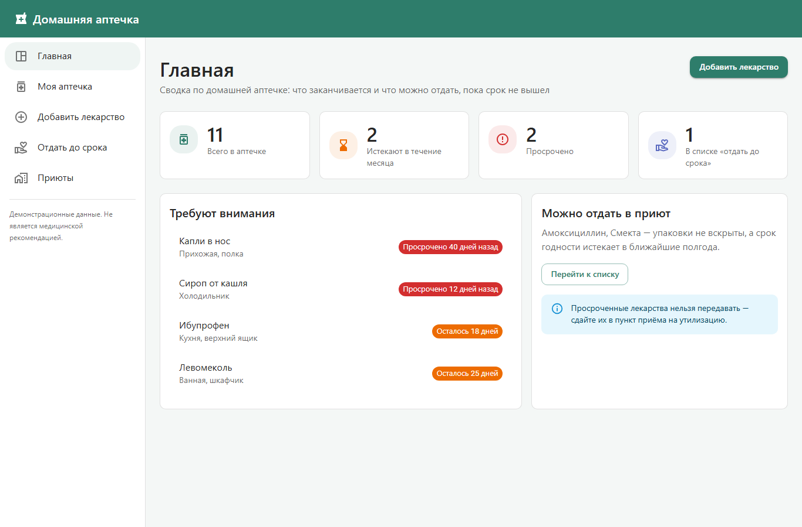
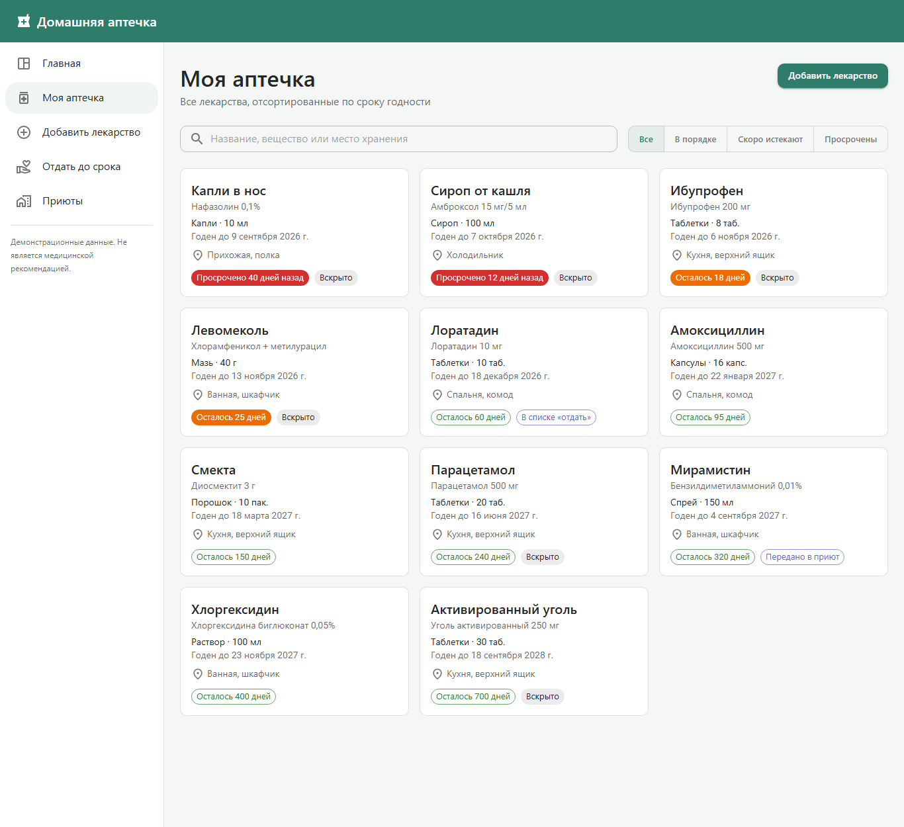
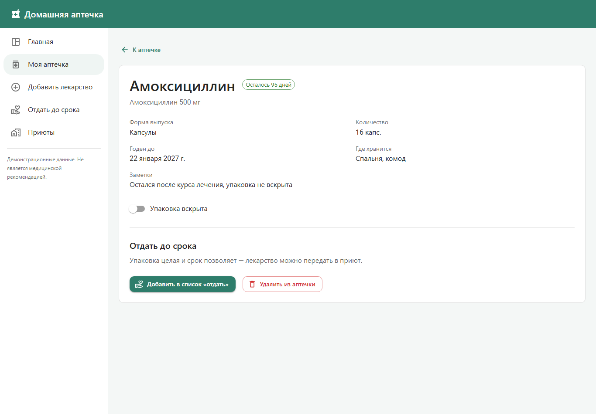
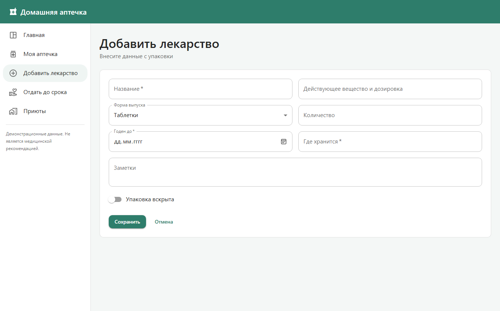
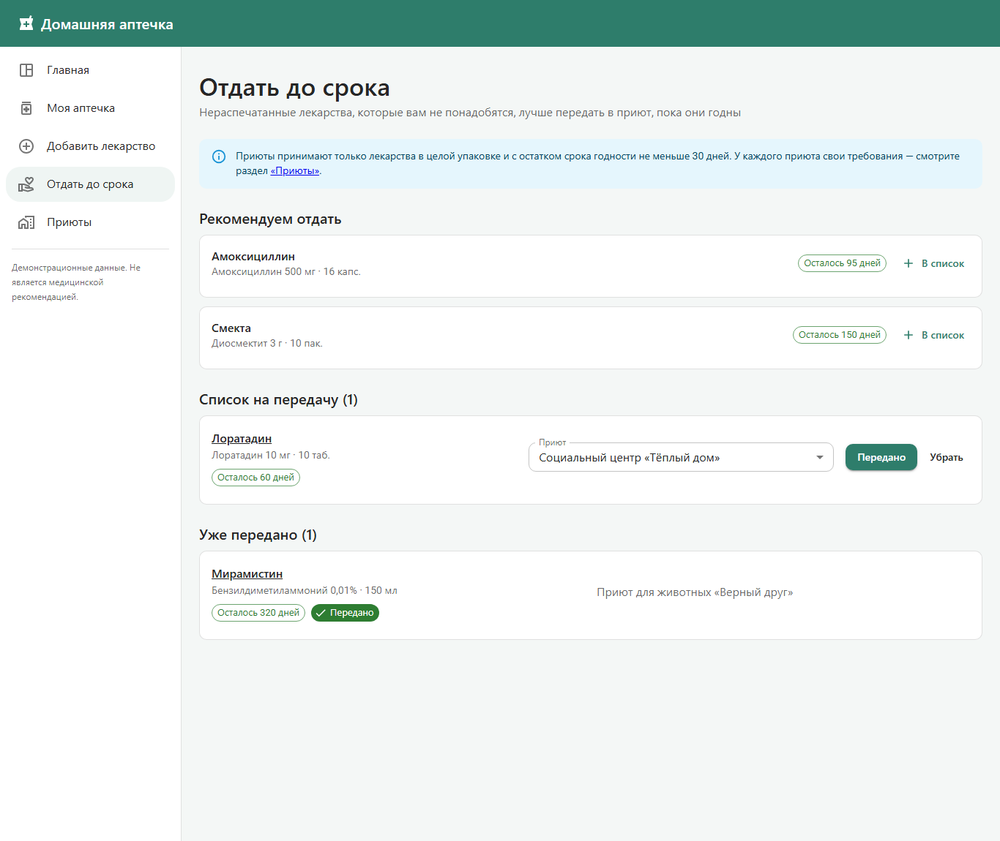
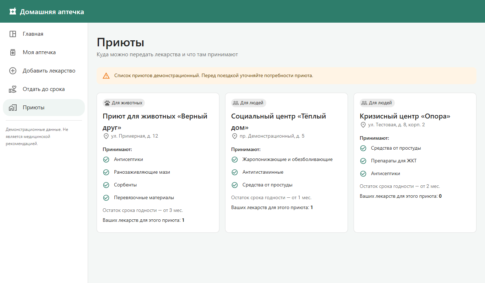
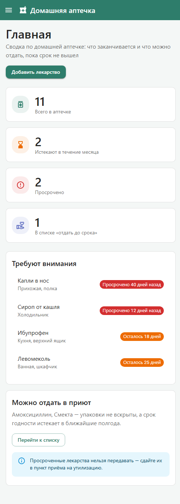
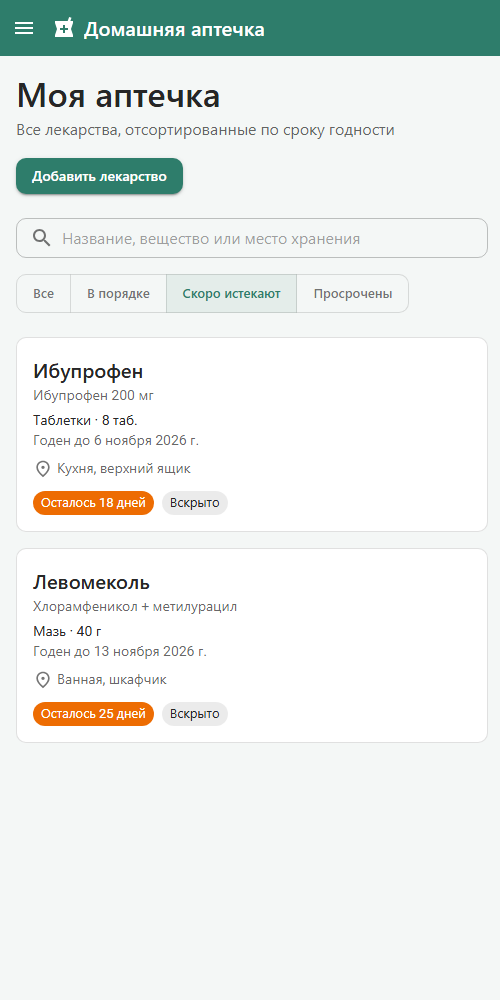
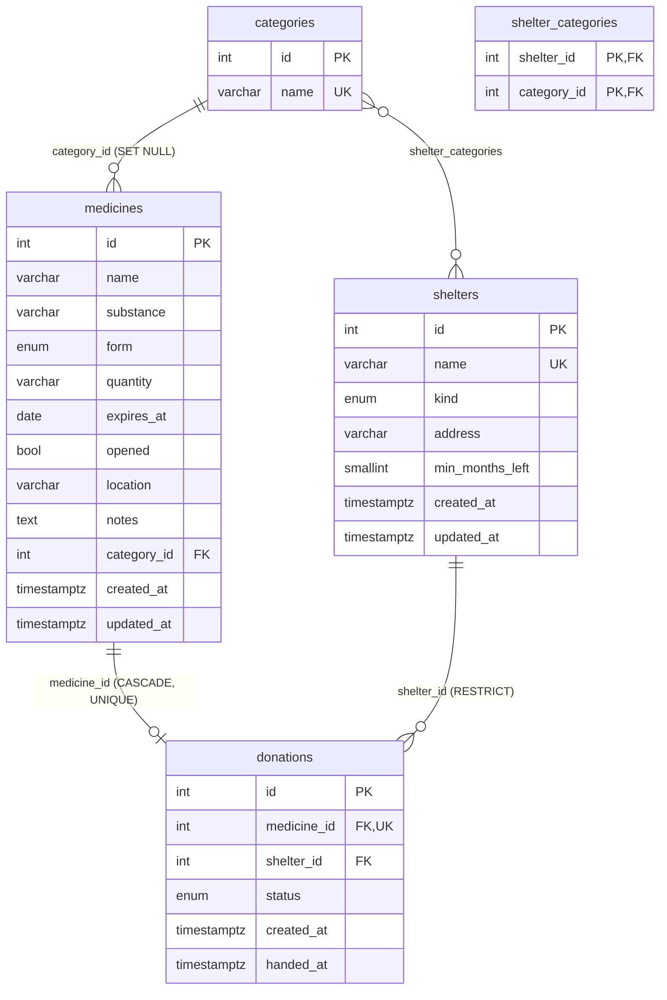
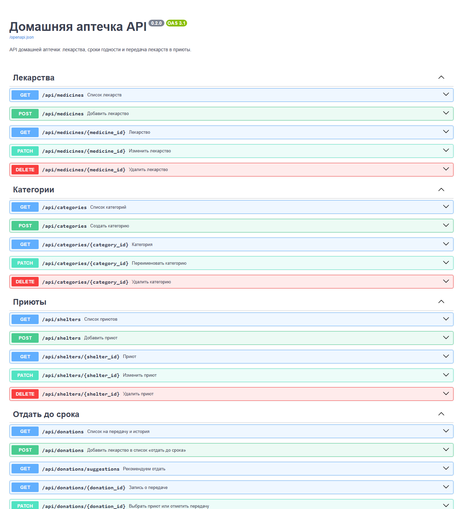

# Домашняя аптечка онлайн

Веб-приложение для учёта домашних лекарств: следит за сроками годности и помогает
вовремя передать ненужные нераспечатанные лекарства в приюты — пока они ещё годны,
а не после того, как их придётся выбросить.

Проект выполняется в рамках курса «Fullstack» (первый семестр).

## Стек

| Часть | Технологии |
|---|---|
| Frontend | React 19, TypeScript, Vite, React Router, MUI (Material UI) |
| Backend | Python 3.12+, FastAPI, Pydantic, Uvicorn |
| База данных | PostgreSQL 17 (в Docker), SQLAlchemy 2, миграции Alembic |
| Тесты backend | pytest |

## Назначение и пользователи

Пользователь — человек, который хранит дома лекарства и хочет:

- знать, что у него есть и где это лежит;
- не пропускать окончание срока годности;
- не выбрасывать лекарства, которые ему не нужны, а отдавать их тем, кому они пригодятся.

## Пользовательские сценарии

1. **Посмотреть состояние аптечки.** Открыть главную страницу и сразу увидеть, сколько
   лекарств просрочено, сколько истекает в течение месяца и что лежит в списке на передачу.
2. **Найти лекарство.** В разделе «Моя аптечка» найти лекарство по названию, действующему
   веществу или месту хранения; отфильтровать по статусу срока годности.
3. **Добавить лекарство.** Заполнить форму с данными с упаковки (название, вещество,
   форма, количество, срок годности, место хранения, вскрыта ли упаковка).
4. **Посмотреть карточку лекарства.** Увидеть все данные, отметить упаковку вскрытой,
   удалить лекарство или добавить его в список «отдать до срока».
5. **Отдать до срока.** Получить рекомендации — нераспечатанные лекарства, у которых
   осталось от 30 до 180 дней, — добавить их в список, выбрать приют и отметить передачу.
6. **Выбрать приют.** Посмотреть приюты, что они принимают и с каким минимальным
   остатком срока годности.

## Экраны

| Экран | Маршрут | Назначение |
|---|---|---|
| Главная | `/` | Сводка: счётчики, лекарства, требующие внимания, рекомендации |
| Моя аптечка | `/medicines` | Список лекарств с поиском и фильтром по статусу (`?status=ok\|soon\|expired`) |
| Карточка лекарства | `/medicines/:id` | Подробности, отметка «вскрыто», добавление в список на передачу, удаление |
| Добавить лекарство | `/medicines/new` | Форма с валидацией обязательных полей |
| Отдать до срока | `/donate` | Рекомендации, список на передачу, выбор приюта, история передач |
| Приюты | `/shelters` | Карточки приютов и их требования |
| 404 | `*` | Несуществующая страница |

### Правила статусов

- **Просрочено** — срок годности уже прошёл (передавать нельзя, только утилизация).
- **Скоро истекает** — осталось 30 дней и меньше.
- **В порядке** — осталось больше 30 дней.
- Передать в приют можно только **невскрытое** лекарство с остатком срока **не меньше 30 дней**;
  у каждого приюта может быть своё, более строгое требование (например, от 3 месяцев).

## Скриншоты

Скриншоты всех экранов лежат в [`docs/screenshots`](docs/screenshots).

| Главная | Моя аптечка |
|---|---|
|  |  |
| **Карточка лекарства** | **Добавить лекарство** |
|  |  |
| **Отдать до срока** | **Приюты** |
|  |  |
| **Мобильная версия: главная** | **Мобильная версия: фильтр «Скоро истекают»** |
|  |  |

## Запуск frontend

Требуется [Node.js](https://nodejs.org/) 20 или новее (проверено на Node.js 24 LTS).

```bash
cd frontend
npm install
npm run dev
```

Приложение откроется на <http://localhost:5173>.

Другие команды:

```bash
npm run build    # проверка типов и production-сборка в frontend/dist
npm run preview  # просмотр production-сборки
npm run lint     # ESLint
```

## Структура frontend

```
frontend/src/
├── components/   # Layout (шапка + меню), карточки, чипы статуса, заголовки страниц
├── pages/        # Экраны приложения
├── store/        # Состояние приложения (React Context)
├── data/         # Демонстрационные данные
├── utils/        # Расчёт сроков годности и статусов
├── types.ts      # Типы предметной области
├── theme.ts      # Тема MUI
└── App.tsx       # Маршруты
```

## Backend

### Модель данных



| Таблица | Назначение |
|---|---|
| `medicines` | Лекарства в аптечке. Статус срока (`expired` / `soon` / `ok`) и `days_left` не хранятся, а вычисляются при ответе |
| `categories` | Группы лекарств: «Антисептики», «Антигистаминные» и т. п. |
| `shelters` | Приюты: тип (`animals` / `people`), адрес, минимальный остаток срока в месяцах |
| `shelter_categories` | Связь «многие ко многим»: какие категории принимает приют. Пустой список — принимает любые |
| `donations` | Список «Отдать до срока»: лекарство (одно лекарство — одна запись), выбранный приют, статус `planned` / `handed` |

Связи и поведение при удалении:

- **лекарство → категория** (многие к одному): при удалении категории у лекарств `category_id` становится `NULL`;
- **приют ↔ категория** (многие ко многим): при удалении приюта или категории удаляются строки связи;
- **лекарство → запись о передаче** (один к одному): при удалении лекарства удаляется и его запись;
- **приют → записи о передаче** (один ко многим): приют с передачами удалить нельзя (`RESTRICT`, ответ 409).

Ограничения в БД: уникальные названия категорий и приютов, `min_months_left >= 0`,
у переданного лекарства обязательно указаны приют и дата передачи (`CHECK`).

### Бизнес-правила

- В список на передачу можно добавить только **невскрытое** лекарство с остатком срока **не меньше 30 дней**.
- Приют принимает лекарство, если остаток срока не меньше его `min_months_left` × 30 дней
  и категория лекарства входит в принимаемые приютом (если список категорий задан).
- Отметить передачу (`status: handed`) можно только после выбора приюта. Переданную запись нельзя изменить или удалить.
- Нельзя изменить лекарство из списка на передачу так, чтобы его стало нельзя передать (например, отметить вскрытым).
- Рекомендации «отдать» — невскрытые лекарства не из списка с остатком срока от 30 до 180 дней.

### API

Документация Swagger доступна после запуска: <http://localhost:8000/docs>.

| Метод и путь | Действие |
|---|---|
| `GET /api/medicines?status=&search=&category_id=` | Список лекарств (фильтры по статусу срока, тексту, категории) |
| `POST /api/medicines` | Добавить лекарство |
| `GET / PATCH / DELETE /api/medicines/{id}` | Получить, изменить, удалить лекарство |
| `GET / POST /api/categories`, `GET / PATCH / DELETE /api/categories/{id}` | CRUD категорий |
| `GET / POST /api/shelters`, `GET / PATCH / DELETE /api/shelters/{id}` | CRUD приютов (`category_ids` — принимаемые категории) |
| `GET /api/donations?status=&shelter_id=` | Список на передачу и история |
| `GET /api/donations/suggestions` | Рекомендуем отдать |
| `POST /api/donations` | Добавить лекарство в список |
| `GET / PATCH / DELETE /api/donations/{id}` | Получить запись, выбрать приют или отметить передачу, убрать из списка |
| `GET /api/health` | Проверка работы API и подключения к БД |

Коды ответов и формат ошибок:

| Код | Когда | Тело ответа |
|---|---|---|
| `200` / `201` / `204` | Успешное чтение / создание / удаление | Данные или пусто |
| `404` | Нет записи с id из адреса | `{"detail": "Не найдено: лекарство с id=999"}` |
| `409` | Нарушено бизнес-правило или ограничение данных | `{"detail": "Передать можно только лекарство в невскрытой упаковке"}` |
| `422` | Некорректные данные или ссылка на несуществующую запись в теле | `{"detail": "Некорректные данные запроса", "errors": [{"field": "name", "message": "Обязательное поле"}]}` |
| `503` | База данных недоступна | `{"detail": "База данных недоступна"}` |



### Структура backend

```
backend/
├── app/
│   ├── main.py            # Создание приложения FastAPI, CORS, обработчики ошибок
│   ├── core/
│   │   ├── config.py      # Конфигурация из переменных окружения / backend/.env
│   │   └── errors.py      # Исключения бизнес-логики (NotFound, Conflict, InvalidReference)
│   ├── db/
│   │   ├── base.py        # Базовый класс моделей, соглашение об именах ограничений
│   │   └── session.py     # Подключение к PostgreSQL, сессия на запрос (get_db)
│   ├── models/            # Модели SQLAlchemy (таблицы и связи)
│   ├── schemas/           # Схемы Pydantic: валидация запросов и формат ответов
│   ├── services/          # Операции с данными и бизнес-правила
│   ├── api/
│   │   ├── routes/        # Маршруты API по сущностям
│   │   ├── router.py      # Общий роутер /api и /api/health
│   │   ├── errors.py      # Перевод исключений в HTTP-ответы с сообщениями на русском
│   │   └── deps.py        # Общие зависимости маршрутов
│   └── seed.py            # Демонстрационные данные
├── alembic/               # Миграции БД
├── tests/                 # Тесты API на отдельной тестовой базе
├── .env.example           # Пример настроек без секретов
└── requirements.txt
```

Запрос проходит слои сверху вниз: `api/routes` (HTTP) → `schemas` (валидация) → `services`
(правила и запросы к БД) → `models` (таблицы). Сервисы не знают про HTTP: они выбрасывают
исключения из `core/errors.py`, а коды ответов выставляет `api/errors.py`.

## Запуск backend

Требуются Python 3.12+ и Docker (для PostgreSQL). Команды выполняются из корня репозитория.

1. **Настройки.** Скопируйте пример и задайте свой пароль БД в `backend/.env`:

   ```bash
   cp backend/.env.example backend/.env
   ```

2. **База данных.** Запустите PostgreSQL в Docker — пользователь, пароль и имя базы берутся из `backend/.env`:

   ```bash
   docker compose up -d db
   ```

   Можно использовать и установленный локально PostgreSQL — тогда укажите его параметры в `backend/.env`.

3. **Зависимости.**

   ```bash
   cd backend
   python -m venv .venv
   .venv\Scripts\activate          # Windows
   # source .venv/bin/activate     # Linux / macOS
   pip install -r requirements.txt
   ```

4. **Создание таблиц** (миграции Alembic):

   ```bash
   alembic upgrade head
   ```

5. **Демонстрационные данные** (необязательно):

   ```bash
   python -m app.seed            # заполнить пустую базу
   python -m app.seed --reset    # очистить и заполнить заново
   ```

6. **Запуск API:**

   ```bash
   uvicorn app.main:app --reload --port 8000
   ```

   API: <http://localhost:8000/api>, документация: <http://localhost:8000/docs>.

### Тесты

```bash
cd backend
pytest
```

Тесты создают отдельную базу `<POSTGRES_DB>_test` на том же сервере и не трогают основную.
Проверяются CRUD всех сущностей, сохранение в БД, связи (каскадное удаление, `SET NULL`,
запрет удаления приюта с передачами), бизнес-правила и сообщения об ошибках.

### Новая миграция после изменения моделей

```bash
alembic revision --autogenerate -m "описание изменения"
alembic upgrade head
```

## Текущее состояние

**ЛР 1.** Реализованы все основные экраны и навигация между ними (React Router), библиотека
компонентов MUI, адаптивная вёрстка. Frontend пока работает на демонстрационных данных
в памяти браузера.

**ЛР 2.** Реализован backend на FastAPI: модель данных из пяти связанных таблиц в PostgreSQL,
CRUD для лекарств, категорий, приютов и списка на передачу, бизнес-правила передачи,
валидация запросов, понятные сообщения об ошибках и HTTP-статусы, миграции Alembic,
демонстрационные данные и автотесты. Подключение frontend к API — в следующих работах.
